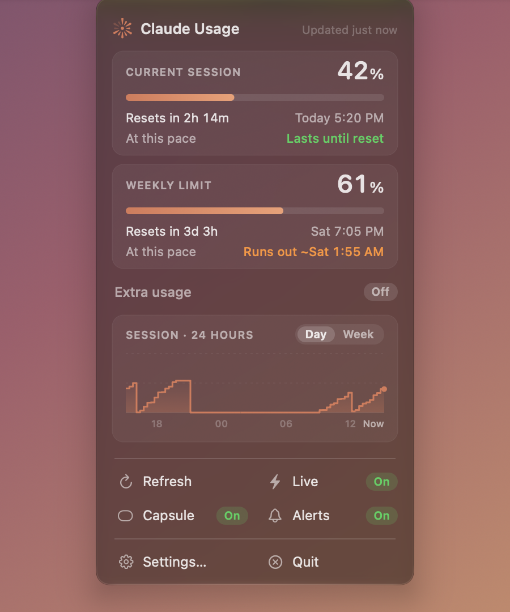
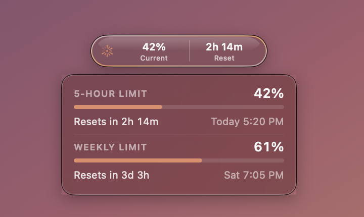
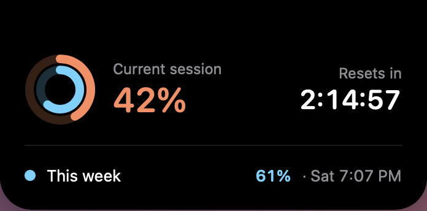
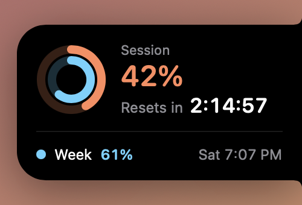
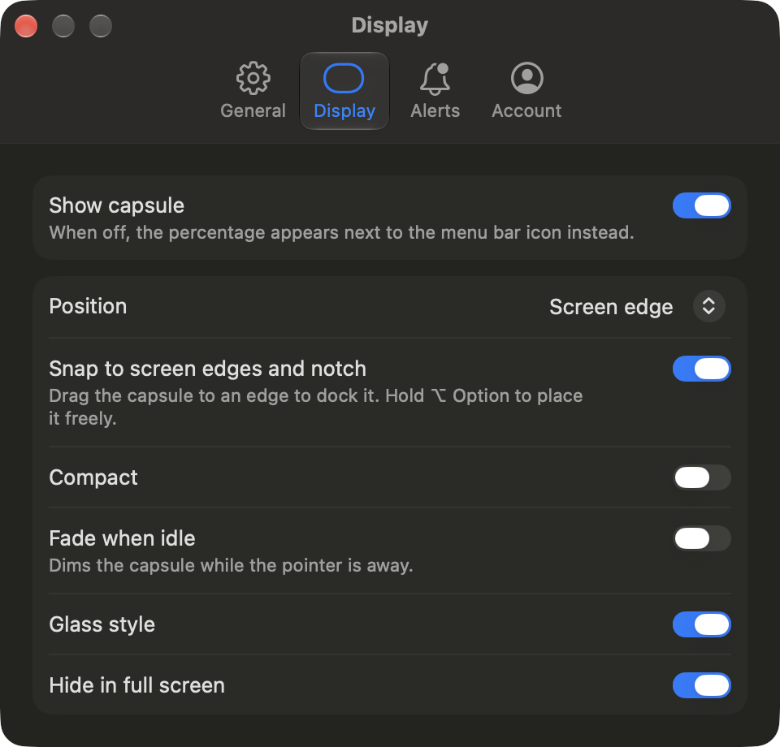

# Claude Usage

**Your Claude plan limits, always in sight.**
A small macOS menu bar app that shows your 5-hour session and weekly usage, 
as a floating capsule, a Dynamic Island under the notch, or a tab on the screen edge.

[**Download the latest version**](https://github.com/NurlanEA/ClaudeUsageBar-releases/releases/latest) · [Support the developer](https://web.tribute.tg/d/UTb) · macOS 14 Sonoma or later · Apple silicon and Intel

 

## Three ways to keep it on screen

<table>
<tr>
<td width="50%" valign="top">

**Floating capsule** 
Session percentage and time to reset. Hover for both limits.

</td>
<td width="50%" valign="top">

**Dynamic Island under the notch** 
Sits around the notch and opens into a card with rings and a live countdown.

</td>
</tr>
<tr>
<td width="50%" valign="top">

**Tab on the screen edge** 
Drag the capsule to any edge and it sticks there like a drop of liquid. Hold <kbd>⌥</kbd> to place it freely.

</td>
<td width="50%" valign="top">

**Settings** 
Placement, snapping, compact mode, alert levels, sign-in and updates.

</td>
</tr>
</table>

## Features

- **Both limits at a glance.** The 5-hour session and the weekly limit, with reset times.
- **Pace forecast.** "At this pace" tells you whether the limit lasts until it resets, or roughly when it runs out.
- **History.** A small chart of the last 24 hours or 7 days, right in the menu.
- **Alerts.** A notification and a short island alert at the levels you choose (80% and 95% by default), and when a limit resets.
- **Only when you need it.** Optionally show the capsule and live updates only while chosen apps, like VS Code, are in front.
- **Light on battery.** Refreshes every 5 minutes, or every 30 seconds in Live mode, and backs off when the server asks.
- **Updates itself.** New versions are checked daily and installed in one click.

## Install

1. Download `ClaudeUsageBar-<version>.zip` from the [latest release](https://github.com/NurlanEA/ClaudeUsageBar-releases/releases/latest) and unzip it.
2. Move **ClaudeUsageBar.app** to your Applications folder.
3. The first time, right-click the app and choose **Open**. The app isn't notarized by Apple yet, so macOS asks once.

## Sign-in

The app needs to read your plan usage. Any one of these works:

| Source | How |
|---|---|
| **Claude Code** | Sign in to Claude Code on this Mac. The app picks it up automatically. |
| **claude.ai session** | Settings → Account → claude.ai session. For Macs with only the Claude app. |
| **Access token** | Run `claude setup-token` on any computer and paste the token in Settings → Account. |

## Privacy

- Credentials stay in your Mac's Keychain.
- The app only talks to Anthropic (`api.anthropic.com`, `claude.ai`) for your usage, and to GitHub to check for updates.
- Usage history is stored locally and never leaves your Mac.

## Support

Claude Usage is free. If it saves you from hitting a limit in the middle of your work, you can support its development:

There is also a **Support** button in the app's menu and in Settings → General.

---

Claude Usage is an independent app and is not affiliated with or endorsed by Anthropic. Claude is a trademark of Anthropic.
